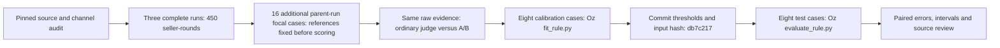

# One evidence pipeline

26 October 2026. The real-source calibration, freeze and held-out test have completed. All performance counts are conditional on provisional source-adjudicated references, pending human review.

The full-run audit supplies process evidence. The additional focal cases permit parent-run-disjoint calibration and test. A measures expressed willingness; B measures selected participation and already uses communication context. Original case labels, model scores and economic consequences are separate facts.

| Method on the same eight test cases | Positive detections | False flags |
| --- | ---: | ---: |
| Evidence audit + Oz rule | 2/2 | 1/6 |
| Ordinary direct judge, same-null calibration | 2/2 | 2/6 |
| Ordinary direct judge, fixed majority | 2/2 | 2/6 |
| Participation B only, same nulls | 2/2 | 1/6 |

The corrected Tara example separates an opening unilateral proposal from supported joint action. The remaining Omar flag comes from one of three B ratings counting the outgoing proposal as action participation; its mean exceeds the fixed cutoff. The rule is not retuned after seeing that error. No independent gain from the AND operator is established.

The integration uses actual `intent_score`, `action_score` and `ordinary_score` columns. Optional CLI arguments preserve original synthetic defaults. `coordinated_action` is the explicit positive target; it is not silently called harmful. Unknown assignment metadata stays unknown. The opt-in order-statistic cutoff prevents tied zero null scores being flagged by an inclusive zero boundary. Ordinary and single-axis baseline B receive the same null-case knowledge as the primary rule; baseline A remains honest-only.

Sources, reference rationales, packets, scores, the frozen rule, fitting/evaluation receipts and exact predictions are in [real_calibration](../results/real_calibration/). [The integrated report](../results/real_calibration/report.md) is the result owner. [Verification](../results/real_calibration/verification.json) confirms the held-out-score change check, hash rejection, tests and unchanged synthetic results. The earlier [descriptive bridge](../results/luna_bridge/) remains a provenance record and is not this calibrated test.
